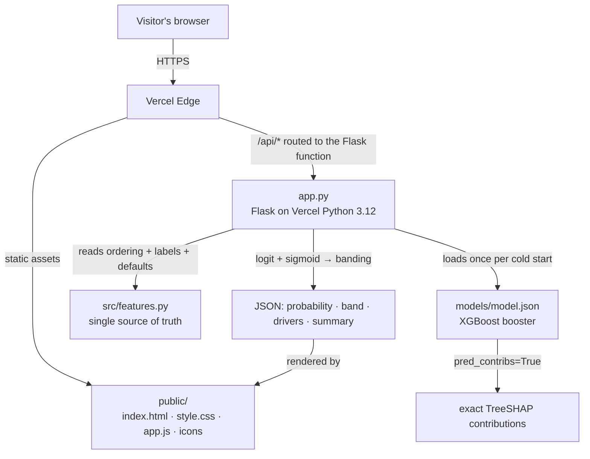

# 🎓 StudentRisk AI

[](LICENSE)
[](https://www.python.org/downloads/)
[](https://flask.palletsprojects.com/)
[](https://xgboost.readthedocs.io/)
[](https://studentrisk-ai.vercel.app)

A vintage-styled web app that predicts a student's risk of failing the year from 24 behavioural
and academic signals — and explains **every** prediction with exact TreeSHAP values plus a
plain-English summary.

**🚀 Live demo: [studentrisk-ai.vercel.app](https://studentrisk-ai.vercel.app)**


Built as a small Flask API serving a hand-crafted single-page frontend. No JavaScript
frameworks, no database, no API keys — the trained model ships with the repo.

## Features

- **Instant risk prediction** — 24 signals in, one probability out, with a colour-coded
  Low / Moderate / High band and a mercury-style risk meter.
- **One-click examples** — load a high/moderate/low-risk profile and watch the score change as
  you adjust any slider.
- **Exact SHAP explanations** — a diverging bar chart of the factors that pushed the score up
  (oxblood) or down (navy), computed by XGBoost's own `pred_contribs=True` — no compiled `shap`
  extension needed.
- **Plain-English summary** — the top drivers translated into readable sentences for non-ML
  readers.
- **PNG export** — download any explanation as a clean image for reports and case notes.
- **Whole-class scan** — drop a CSV of a full roster, get everyone ranked with their strongest
  driver, band counts, and a downloadable report.
- **Zero-config deploy** — Vercel detects the Flask app and serves the frontend from `public/`.
- **Reproducible training** — `src/train.py` regenerates `models/model.json` and
  `models/metrics.json` from the bundled UCI data with a fixed seed.

## Architecture



The web encoder (`encode_values`) and the training encoder (`src.features.encode`)
are kept bug-compatible by a pytest parity test, so the offline training pipeline and
the live API always speak the same feature language.

## Quick start

```bash
python -m venv .venv
# Linux / macOS
source .venv/bin/activate
# Windows PowerShell
.venv\Scripts\Activate.ps1

pip install -r requirements.txt
python app.py            # → http://localhost:5000
```

The model and metrics ship with the repo — no configuration required.

## Deploy on Vercel

1. Push this repo to GitHub (already done: `Culzz/StudentRisk-AI`).
2. Go to [vercel.com/new](https://vercel.com/new) and import the repository — Vercel
   auto-detects Flask from `requirements.txt` and the top-level `app` in `app.py`.
   The `.python-version` file pins Python 3.12.
   *(If the build skips the Python step, open the project's Settings → Framework
   and set it to **Python** — that forces the serverless route.)*
3. Deploy. No build command, no environment variables, no database.

The frontend is served from `public/` (Vercel's CDN); `app.py` handles the API routes.

## API

| Method | Endpoint | Purpose |
|---|---|---|
| `GET` | `/api/health` | Liveness probe |
| `GET` | `/api/schema` | Feature definitions, presets, band thresholds, metrics |
| `POST` | `/api/predict` | One student → probability, band, full SHAP breakdown |
| `POST` | `/api/batch` | Up to 2,000 students → probability, band, strongest driver |

Example:

```bash
curl -X POST http://localhost:5000/api/predict \
  -H "Content-Type: application/json" \
  -d '{"values": {"G1": 6, "G2": 7, "failures": 2, "absences": 30, "sex": "Female", "area": "Urban"}}'
```

`/api/predict` accepts partial objects — anything omitted falls back to the schema default,
so a two-field request already returns a valid prediction.

## Retraining

```bash
pip install -r requirements-train.txt   # adds pandas, matplotlib, scikit-learn on top of the app deps
python src/train.py                     # regenerates models/model.json + models/metrics.json
python src/train.py --help              # all options
```

## Model

- Data: [UCI Student Performance](https://archive.ics.uci.edu/dataset/320/student+performance)
  (1,044 course records — 395 Maths + 649 Portuguese — from **661 unique
  students**, grouped split verified below).
- Target: final grade `G3 < 10` (failing the year).
- 24 features: term grades, study time, past failures, absences, going out, alcohol use,
  health, family support, and background.
- **Split: grouped by student** (`GroupShuffleSplit`, seed 42) — the 1,044 records cover
  661 students because 366 of them attend both course files; a plain row split would put
  the same student on both sides (leakage). The identity hash that reproduces the UCI
  merge count is exactly the demographic core: school, sex, age, address, family size &
  status, parental education/jobs, reason and guardian. Survey-reported habits are
  recorded per course and are too noisy to serve as identity.

### Ablation — what each feature block is really worth

Same XGBoost configuration, same leakage-free grouped split, three feature sets,
plus the one-line rule a sceptical reviewer would suggest:

| Variant | Accuracy | ROC-AUC | Recall @0.2 | Recall @0.5 |
|---|---|---|---|---|
| All 24 features (term-2 standings view) | **93.8%** | 0.972 | 0.905 | 0.857 |
| Without `G2` | 88.5% | 0.929 | 0.810 | 0.762 |
| Without `G1`/`G2` (true early-warning view) | 81.7% | 0.725 | 0.524 | 0.262 |
| Rule: `G2 < 10` alone | 91.4% | 0.975 | — | **0.952** |

Three honest takeaways:

1. **With term-2 grades in hand, G2 nearly is the answer.** The trained model barely
   beats the trivial `G2 < 10` rule on accuracy and loses to it on recall — so when the
   term grade exists, prefer the obvious screen; the model's extra edge is marginal.
2. **The model's real value is as an early-warning view.** Without `G2` it still reaches
   **0.93 AUC / 76% recall at the 0.5 threshold** — genuinely useful before the decisive
   term grade lands. Dropping both term grades degrades it to a weak pointer
   (0.72 AUC) — background variables alone don't separate risk well.
3. **Calibration is good at the extremes, mushy in the middle** — Brier **0.077**; the
   bottom-decile predictions land at 0–5% observed risk and the top decile at 95%, but
   the mid-range over-predicts certainty (a bucket predicted at 0.08 saw 0.48). Read
   mid-band scores as "needs a human decision", not as a number.

Full machine-readable versions of all three tables live in
[`models/metrics.json`](models/metrics.json) (`ablation`, `grouping`,
`calibration` keys); retraining regenerates them with `src/train.py` +
`src/ablate.py`.

## Tests

```bash
pip install -r requirements-dev.txt
pytest tests/
```

The suite includes parity checks: the web encoder must produce the same feature vector as the
training pipeline's `src.features.encode`, and the API's probabilities must match XGBoost's
sklearn wrapper to float precision.

## Layout

```
app.py                  Flask app: static serving + JSON API (this is what Vercel runs)
public/index.html       Single-page frontend (hand-crafted, no framework)
public/assets/          style.css (vintage design system) · app.js (form, chart, CSV)
src/features.py         Shared feature schema (single source of truth)
src/train.py            Training script
models/                 Trained model (model.json) + metrics (metrics.json)
data/                   UCI CSVs + attribute descriptions
tests/test_api.py       API + parity tests
```

## Security and Privacy

- **Stateless by design** — no accounts, no cookies, no database: nothing about a
  visitor is stored server-side or written to disk at request time.
- **No secrets** — the app needs zero environment variables; the model ships in-repo.
- **Upload safety** — `/api/batch` only accepts JSON arrays of plain objects
  (2,000 rows max), never files; nothing is eval'd or written.
- **Honest limits** — there is no rate limiting or API key yet; if you expose it
  publicly beyond Vercel's scale guardrails, add one first.

## Roadmap

- [ ] **Early-warning mode in the app** — ship the no-`G2` model as a "term-1" toggle
  alongside the standings view (the ablation already shows its 0.93 AUC is real)
- [ ] **Fairness audit** — error rates by sex and urban/rural; test dropping protected
  attributes and show the effect
- [ ] **Intervention recommendations** — map each flagged student's top *changeable*
  driver (absences, study time) to a concrete action
- [ ] **Capacity triage list** — "I can follow up with 8 students this week" → the exact
  ranked list, reason beside each name (recall at a capped review budget)
- [ ] Probability recalibration (Platt scaling) applied to the served score

## Limitations & Ethics

- **Provenance scope**: trained on Portuguese secondary-school data (2005–2006). Treat
  performance on other populations — including Nigerian universities — as *unvalidated*
  until the pipeline is retrained locally with that country's grading context.
- **Not an early-warning oracle without grades**: with both term grades the model
  tracks standings (see Ablation); before term grades exist, background-only signals
  reach just 0.72 AUC — use the without-`G2` running view and always pair the score
  with a human check.
- **Mid-band probabilities are soft**: calibration is tight at 0–5% and >95% risk, but
  scores between ~0.1 and ~0.6 over-predict certainty; a "Moderate risk" score means
  *look closer*, not *this student will fail*.
- **Decision support, not a decision.** Predictions are statistical estimates that must
  never replace a teacher's judgement, and should not be the sole basis for any action
  about a student.
- **Fairness not yet audited**: the feature list includes sex, urban/rural address and
  parental education — screening naturally waters demographic pasts; group-level error
  rates are not analysed yet (tracked in the roadmap) and protected-attribute inputs
  should be dropped before any real-world rollout.

## Citation

The dataset is released under [CC BY 4.0](https://creativecommons.org/licenses/by/4.0/).

> Cortez, P. (2008). *Student Performance* [Dataset]. UCI Machine Learning Repository.
> https://doi.org/10.24432/C5TG7T

## License

Released under the [MIT License](LICENSE).

## Author

**Omeche Chimaobi Benedict** — [github.com/Culzz](https://github.com/Culzz) · Omechechima@gmail.com
