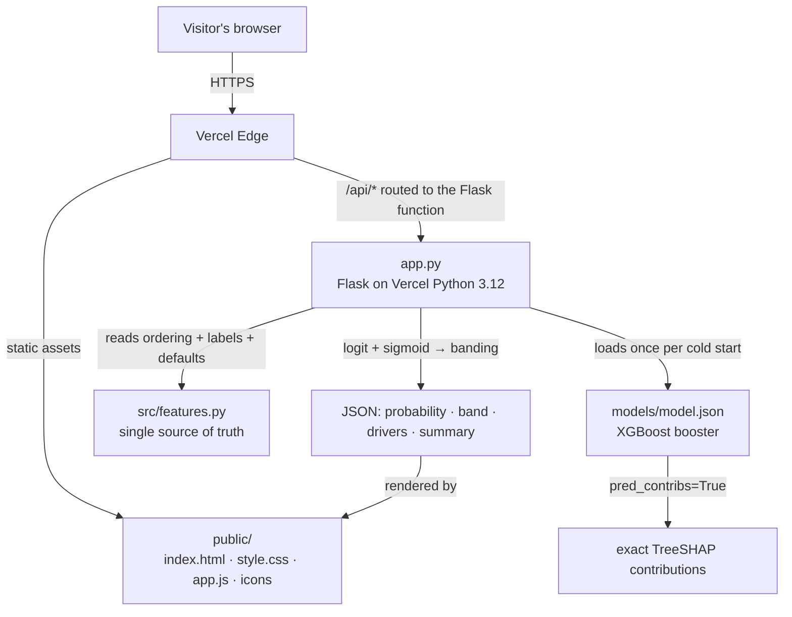

# 🎓 StudentRisk AI

[](LICENSE)
[](https://www.python.org/downloads/)
[](https://flask.palletsprojects.com/)
[](https://xgboost.readthedocs.io/)
[](https://studentrisk-ai.vercel.app)

A vintage-styled web app that predicts a student's risk of failing the year from 24 behavioural
and academic signals — and explains **every** prediction with exact TreeSHAP values plus a
plain-English summary.

**🚀 Live demo: [studentrisk-ai.vercel.app](https://studentrisk-ai.vercel.app)**


Built as a small Flask API serving a hand-crafted single-page frontend. No JavaScript
frameworks, no database, no API keys — the trained model ships with the repo.

## Features

- **Instant risk prediction** — 24 signals in, one probability out, with a colour-coded
  Low / Moderate / High band and a mercury-style risk meter.
- **One-click examples** — load a high/moderate/low-risk profile and watch the score change as
  you adjust any slider.
- **Exact SHAP explanations** — a diverging bar chart of the factors that pushed the score up
  (oxblood) or down (navy), computed by XGBoost's own `pred_contribs=True` — no compiled `shap`
  extension needed.
- **Plain-English summary** — the top drivers translated into readable sentences for non-ML
  readers.
- **PNG export** — download any explanation as a clean image for reports and case notes.
- **Whole-class scan** — drop a CSV of a full roster, get everyone ranked with their strongest
  driver, band counts, and a downloadable report.
- **Zero-config deploy** — Vercel detects the Flask app and serves the frontend from `public/`.
- **Reproducible training** — `src/train.py` regenerates `models/model.json` and
  `models/metrics.json` from the bundled UCI data with a fixed seed.

## Architecture



The web encoder (`encode_values`) and the training encoder (`src.features.encode`)
are kept bug-compatible by a pytest parity test, so the offline training pipeline and
the live API always speak the same feature language.

## Quick start

```bash
python -m venv .venv
# Linux / macOS
source .venv/bin/activate
# Windows PowerShell
.venv\Scripts\Activate.ps1

pip install -r requirements.txt
python app.py            # → http://localhost:5000
```

The model and metrics ship with the repo — no configuration required.

## Deploy on Vercel

1. Push this repo to GitHub (already done: `Culzz/StudentRisk-AI`).
2. Go to [vercel.com/new](https://vercel.com/new) and import the repository — Vercel
   auto-detects Flask from `requirements.txt` and the top-level `app` in `app.py`.
   The `.python-version` file pins Python 3.12.
   *(If the build skips the Python step, open the project's Settings → Framework
   and set it to **Python** — that forces the serverless route.)*
3. Deploy. No build command, no environment variables, no database.

The frontend is served from `public/` (Vercel's CDN); `app.py` handles the API routes.

## API

| Method | Endpoint | Purpose |
|---|---|---|
| `GET` | `/api/health` | Liveness probe |
| `GET` | `/api/schema` | Feature definitions, presets, band thresholds, metrics |
| `POST` | `/api/predict` | One student → probability, band, full SHAP breakdown |
| `POST` | `/api/batch` | Up to 2,000 students → probability, band, strongest driver |

Example:

```bash
curl -X POST http://localhost:5000/api/predict \
  -H "Content-Type: application/json" \
  -d '{"values": {"G1": 6, "G2": 7, "failures": 2, "absences": 30, "sex": "Female", "area": "Urban"}}'
```

`/api/predict` accepts partial objects — anything omitted falls back to the schema default,
so a two-field request already returns a valid prediction.

## Retraining

```bash
pip install -r requirements-train.txt   # adds pandas, matplotlib, scikit-learn on top of the app deps
python src/train.py                     # regenerates models/model.json + models/metrics.json
python src/train.py --help              # all options
```

## Model

- Data: [UCI Student Performance](https://archive.ics.uci.edu/dataset/320/student+performance)
  (1,044 course records — 395 Maths + 649 Portuguese — from 662 unique students).
- Target: final grade `G3 < 10` (failing the year).
- 24 features: term grades, study time, past failures, absences, going out, alcohol use,
  health, family support, and background.
- Split: stratified 80/20, `random_state=42`.

| Metric | Value |
|---|---|
| Test accuracy | **88.5%** |
| ROC-AUC | **0.9415** |
| Train / test size | 835 / 209 |
| At-risk rate | 22.0% |

Exact values live in [`models/metrics.json`](models/metrics.json); retraining reproduces them.

## Tests

```bash
pip install -r requirements-dev.txt
pytest tests/
```

The suite includes parity checks: the web encoder must produce the same feature vector as the
training pipeline's `src.features.encode`, and the API's probabilities must match XGBoost's
sklearn wrapper to float precision.

## Layout

```
app.py                  Flask app: static serving + JSON API (this is what Vercel runs)
public/index.html       Single-page frontend (hand-crafted, no framework)
public/assets/          style.css (vintage design system) · app.js (form, chart, CSV)
src/features.py         Shared feature schema (single source of truth)
src/train.py            Training script
models/                 Trained model (model.json) + metrics (metrics.json)
data/                   UCI CSVs + attribute descriptions
tests/test_api.py       API + parity tests
```

## Security and Privacy

- **Stateless by design** — no accounts, no cookies, no database: nothing about a
  visitor is stored server-side or written to disk at request time.
- **No secrets** — the app needs zero environment variables; the model ships in-repo.
- **Upload safety** — `/api/batch` only accepts JSON arrays of plain objects
  (2,000 rows max), never files; nothing is eval'd or written.
- **Honest limits** — there is no rate limiting or API key yet; if you expose it
  publicly beyond Vercel's scale guardrails, add one first.

## Limitations & Ethics

- The model is trained on Portuguese secondary-school data (2005–2006); treat performance on
  other populations as unvalidated until retrained locally.
- The 1,044 records come from 662 unique students, so the same student's two course records can
  land on both sides of the 80/20 split — the model sees overlapping individuals across train
  and test, and the metrics must be read with that in mind.
- Predictions are statistical estimates for **decision support only** — they must never replace
  a teacher's judgement, and should not be used as the sole basis for any decision about a
  student.

## Citation

The dataset is released under [CC BY 4.0](https://creativecommons.org/licenses/by/4.0/).

> Cortez, P. (2008). *Student Performance* [Dataset]. UCI Machine Learning Repository.
> https://doi.org/10.24432/C5TG7T

## License

Released under the [MIT License](LICENSE).

## Author

**Omeche Chimaobi Benedict** — [github.com/Culzz](https://github.com/Culzz) · Omechechima@gmail.com
